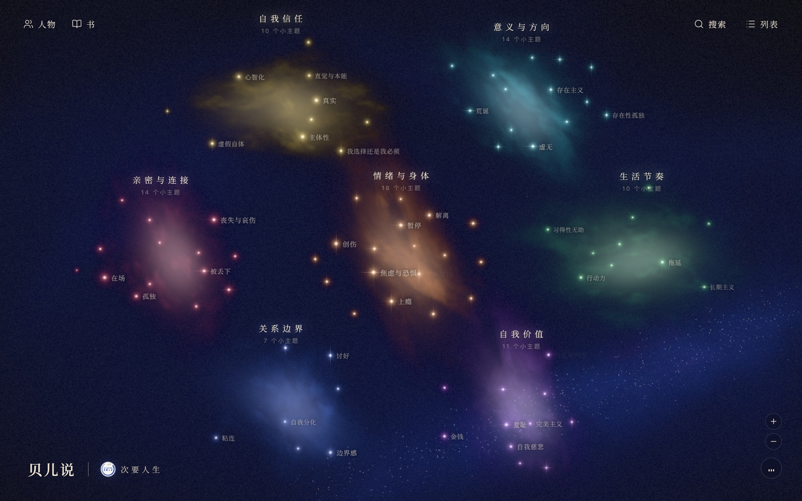
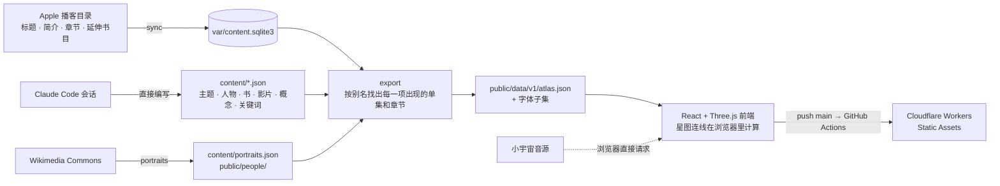

# 贝儿说

《次要人生｜Flip Your Mind》的主题星图。7 个大主题是星云，84 个小主题是星星，两颗星之间的线是同时谈到它们的某一期节目。点开一颗星，能看到它在哪几期、哪一章出现，并从那一章开头直接播放原节目。

内容只来自节目公开的目录：单集标题、简介、章节时间戳和延伸书目。**没有转录，也没有逐字稿。** 主题、人物、书、影片和概念都由 Claude Code 会话整理成 `content/` 里的 JSON 文件，导出时程序再到目录里找出它们出现的位置。

[](https://beiershuo.chenxi.dev/)

在线访问：<https://beiershuo.chenxi.dev/>

## 网站上能做什么

- **星图。** 每团星云一个主题，颜色各不相同。「情绪与身体」和其他主题的连线最多，所以放在中间，其余六个围成一圈，连线多的主题彼此相邻。小主题和其他小主题的连线越多，星星越大，文字也越大。
- **悬停和点选。**
  - 鼠标停在一颗星或它的文字上，只显示这颗星和它连线连到的词，其他文字隐藏。
  - 点选一颗星后，显示它连到的词，其他文字变淡。
  - 没有悬停也没有点选时，每团星云只显示连接最多的几个词。放大后显示的词越来越多，两个词不会重叠。
  - 线只在悬停或点选时出现。
- **3D 视图。** 右下角的「3D」开关会把平面星图展开成立体的：外圈的星云在中心前后交错，星星在每团星云里也前后散开，连线从中心向外拱成穹顶。拖动旋转，Shift + 拖动平移，滚轮或双指缩放；不操作时整片星空缓慢转动。选择记在本机浏览器里。
- **详情卡片。** 停靠在右侧，可以收起。卡片上列出这个小主题出现的单集和章节，点一下从章节开头播放；还列出常和它一起出现的小主题。
- **列表。** 按单集排列，每一集默认收起，可以筛选，也可以从头播放。
- **搜索。** 按 `⌘K` 打开全屏搜索：主题、人物、书、影片、概念和日常关键词在一个慢慢转动的球面上，输入时命中的词飘到前面。
- **人物、书、影片和概念页。** 左上角进入索引页，每一项都有自己的页面：人物配 Wikimedia Commons 上自由授权的照片和维基百科链接，书和影片配本站设计的封面和豆瓣搜索链接。页面以面板形式盖在星图上，✕、Esc 或点空白处直接回到星图。
- **分享卡片。** 在人物、书、影片和概念页上生成一张 3:4 的图，列出它在哪几期出现，并附上通往这一页的二维码；这一页上有在小宇宙订阅的入口。
- **背景音乐。** 右下角开关；播放单集时自动压低。

## 架构



- **数据源只有公开目录。** `sync` 读取 Apple 播客的节目目录（54 集、892 个章节），存进本地 SQLite。小宇宙链接和音源地址也来自这里。
- **由 Claude Code 会话整理内容，不用 API key。** 会话直接编写 `content/` 下的文件，内容都留在 git 里，可以追溯。
- **出现位置靠别名匹配。** `export` 在单集标题、官方主题、章节标题和延伸书目里查找每一项的别名，重叠时以较长的别名为准，比如《笛卡尔的错误》算作这本书，不再单独算作「笛卡尔」。新单集同步后重新导出就会更新，不用手工补。
- **星图上的线在浏览器里计算**（`src/App.tsx` 的 `buildGalaxy`）：两个小主题在同一期都出现过，就算一次连接。每个小主题保留 3 个连接最强的伙伴，每对最多画最近的 3 期，一期一条线。星星的大小按连接的伙伴数取对数。
- **网站是纯静态的。** Cloudflare 只托管网页、`atlas.json`、字体子集和图片，没有服务端代码。播放时浏览器直接请求小宇宙的原节目音源，从章节时间戳开始。

## 内容文件

| 文件 | 内容 | 谁维护 |
| --- | --- | --- |
| `content/topics.json` | 7 个主题：`id`、标题、说明、搜索别名、颜色、位置（中心加一圈，见上文） | Claude Code 会话 |
| `content/entities.json` | 84 个概念（每个带所属主题 `topic`，就是星图上的小主题）、45 位人物、28 本书、3 部影片或节目：名字、别名、一句话说明、作者或相关人物 | Claude Code 会话 |
| `content/keywords.json` | 听众可能搜的日常词（内耗、安全感、迷茫……），没在目录里出现过的不会进快照 | Claude Code 会话 |
| `content/episodes.json` | 单集的附加设置，`musicBed: true` 表示这一集自带背景音乐（EP50、EP51） | 手动 |
| `content/portraits.json` | 人物照片的来源、作者、授权和维基百科链接（目前 37 位有照片） | `pipeline portraits` 生成 |
| `content/proposals/*.json` | 单集主题和章节连线的提议（见「审核队列」） | Claude Code 会话 |

## 本地开发

需要 Node 22.12+。只有刷新数据时才需要 Python 3.12。

```bash
npm install
npm run dev            # http://localhost:5173/，读取仓库里现有的 atlas.json
```

刷新数据：

```bash
/opt/homebrew/bin/python3.12 -m venv .venv
.venv/bin/pip install -r requirements.txt

.venv/bin/python -m pipeline sync        # 重新拉取 Apple 目录
.venv/bin/python -m pipeline portraits   # 补人物照片和维基百科链接（有节流，会慢）
.venv/bin/python -m pipeline export      # 校验引用，写 public/data/v1/atlas.json 和字体子集
.venv/bin/python -m pipeline status
```

加新的人物、书或概念：在 `content/entities.json` 里加一项（概念要写所属主题 `topic`），然后运行 `export`。字体子集是按快照里实际用到的字从思源宋体生成的，所以加了新字也要重新导出；本机没有思源宋体时不会生成子集，新加的字会用系统宋体显示。

## 审核队列（还没用上）

`content/proposals/` 里有 54 条单集主题提议和 37 条章节之间的连线提议，可以导入本地审核页逐条通过或驳回：

```bash
.venv/bin/python -m pipeline propose --catalog --from-file content/proposals/catalog-1.json
.venv/bin/python -m pipeline propose --catalog --from-file content/proposals/catalog-2.json
.venv/bin/python -m pipeline propose --catalog --from-file content/proposals/links.json
.venv/bin/python -m pipeline review serve   # http://127.0.0.1:8787
```

目前一条都还没通过，所以快照里单集的 `topicIds` 和 `chapterPaths` 都是空的，网站也没用到它们。通过的条目会在下一次 `export` 时进入快照。

## 没有启用的部分

代码里留着一条按原声做的流程，但从来没有运行过，网站也不依赖它：

- `transcribe` 和 `enroll`：用留声（本机项目 `~/Projects/daily-recall`）的转录与声纹分段处理单集音频（需要 Voxt、`campplus.onnx` 和 pyannote 模型，`requirements.txt` 里的 `numpy` 和 `sherpa-onnx` 只给它们用）。
- `summarize` 和 `relate`：转录之后的阶段，目前只是占位。
- `pipeline/llm.py`：直接调用 Anthropic API 的路径，默认流程不用。

## 数据结构

`public/data/v1/atlas.json`，类型定义见 `src/domain.ts`：

| 字段 | 内容 |
| --- | --- |
| `show` | 节目名、主播、小宇宙和 Apple 链接 |
| `topics` | 7 个主题 |
| `episodes` | 54 集：Apple GUID、标题、期号、发布时间、时长、音源、小宇宙和 Apple 链接、官方主题、章节（延伸书目只在导出时用来找出现位置，不进快照） |
| `moments` | 892 个片段，目前全部来自章节时间戳（`source: "show_notes"`）：所属单集、起止时间、标题、摘要 |
| `entities` | 160 项人物、书、影片和概念，以及每一处出现的单集、章节和起播点 |
| `keywords` | 搜索建议词和它们在目录里出现的次数 |
| `relations`、`chapterPaths` | 留给审核通过的连线，目前为空 |

链接：

- `/?topic=emotion-body` 打开一团星云，`/?star=<概念 id>` 选中一颗星。
- `/people/winnicott`、`/books/<id>`、`/films/<id>`、`/concepts/<id>` 是各自的页面。
- `/people`、`/books`、`/films`、`/concepts` 是索引页。

## 发布

推送到 `main` 后，GitHub Actions（`.github/workflows/deploy.yml`）会安装依赖、构建，并用 `wrangler deploy` 发布到 Cloudflare，大约 40 秒。仓库需要两个 secret：`CLOUDFLARE_API_TOKEN`（用「Edit Cloudflare Workers」模板创建，包含 `chenxi.dev` 这个 zone）和 `CLOUDFLARE_ACCOUNT_ID`。不要把本机 `wrangler login` 的登录信息复制给 CI：它的刷新令牌只能用一次，CI 用掉后本机和 CI 会一起掉线。

```bash
npm run build          # tsc + vite build，输出到 dist/
npm run preview        # 本地预览生产构建
npm run deploy         # 本机直接发布，需要先 npx wrangler login
```

站点同时挂在 `beiershuo.chenxi.dev` 和 workers.dev 地址上。`chenxi.dev` 这个 zone 的安全设置偶尔会把第一次请求 `atlas.json` 拦成 403，前端会自动重试两次；要彻底解决，可以在 Cloudflare 的 Security → Events 里找到对应规则，为这个子域放行。

### 截图

README 顶部的 `docs/landing.jpg`（1440×900）和链接预览图 `public/og.jpg`（1200×630，`index.html` 里的 og/twitter 标签指向它）都是开着 `npm run dev` 时用无头 Chrome 截的。星图改版后重截：

```bash
CH="/Applications/Google Chrome.app/Contents/MacOS/Google Chrome"
"$CH" --headless=new --hide-scrollbars --window-size=1200,630 --force-device-scale-factor=2 --virtual-time-budget=8000 --screenshot="$TMPDIR/og.png" http://localhost:5173/
sips -s format jpeg -s formatOptions 86 --resampleWidth 1200 "$TMPDIR/og.png" --out public/og.jpg
"$CH" --headless=new --hide-scrollbars --window-size=1440,900 --force-device-scale-factor=2 --virtual-time-budget=8000 --screenshot="$TMPDIR/landing.png" http://localhost:5173/
sips -s format jpeg -s formatOptions 84 --resampleWidth 2160 "$TMPDIR/landing.png" --out docs/landing.jpg
```

截图前把本机浏览器里的视图切回平面：无头 Chrome 用的是独立的配置目录，默认就是平面。

## 背景音乐

网站循环播放 `public/audio/bgm.mp3`（《Iki》Hideyuki Hashimoto），文件由站长提供，播放时按钮旁显示署名（`src/ambient.ts` 的 `TRACK_CREDIT`）。打开页面就自动播放；浏览器拦截有声自动播放时，第一次点击页面后开始。播放单集时背景音乐压低，标了 `musicBed` 的单集则完全静音。没有这个文件时，退回浏览器里实时生成的原创音乐。

## 字体

`public/fonts/beier-serif-*.woff2` 是思源宋体的子集，按 SIL Open Font License 1.1 分发，见 `public/fonts/NOTICE.txt`。
