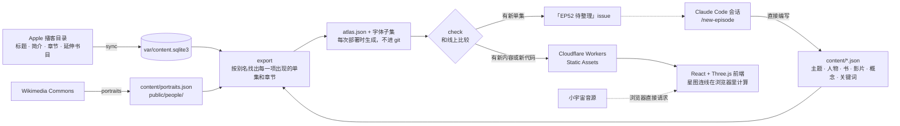

# 贝儿说

《次要人生｜Flip Your Mind》的主题星图。7 个大主题是星云，84 个小主题是星星，两颗星之间的线是同时谈到它们的某一期节目。点开一颗星，能看到它在哪几期、哪一章出现，并从那一章开头直接播放原节目。

内容只来自节目公开的目录：单集标题、简介、章节时间戳和延伸书目。**没有转录，也没有逐字稿。** 主题、人物、书、影片和概念都由 Claude Code 会话整理成 `content/` 里的 JSON 文件，导出时程序再到目录里找出它们出现的位置。

[](https://beiershuo.chenxi.dev/)

在线访问：<https://beiershuo.chenxi.dev/>

## 网站上能做什么

- **星图。** 每团星云一个主题，颜色各不相同。「情绪与身体」和其他主题的连线最多，所以放在中间，其余六个围成一圈，连线多的主题彼此相邻。小主题和其他小主题的连线越多，星星越大，文字也越大。
- **悬停和点选。**
  - 鼠标停在一颗星或它的文字上，只显示这颗星和它连线连到的词，其他文字隐藏。
  - 点选一颗星后，显示它连到的词，其他文字变淡。
  - 没有悬停也没有点选时，每团星云只显示连接最多的几个词。放大后显示的词越来越多，两个词不会重叠。
  - 线只在悬停或点选时出现。
- **3D 视图。** 右下角的「3D」开关会把平面星图展开成立体的：外圈的星云在中心前后交错，星星在每团星云里也前后散开，连线从中心向外拱成穹顶。拖动旋转，Shift + 拖动平移，滚轮或双指缩放；不操作时整片星空缓慢转动。选择记在本机浏览器里。
- **详情卡片。** 停靠在右侧，可以收起。卡片上列出这个小主题出现的单集和章节，点一下从章节开头播放；还列出常和它一起出现的小主题。
- **单集时间轴。** 右边缘每一集是一道刻度，最新的在上、最早的在下。指针移过去，附近的刻度像程序坞一样放大，旁边写出是哪一集，星图上点亮这一集谈到的小主题，并按谈到的先后连成一个星座。点一下打开单集卡片：从头听、分享、谈到的小主题、提到的人和书、全部章节。滚轮和方向键一格走一集。手机上用手指上下拖，每过一集轻震一下，松手打开那一集；时间轴旁平时只留年份，手指按住时才显示各月。手机上的单集卡片先收成一条，只有标题、从头听和分享，星图把这一集的小主题框进上方的天空，点箭头展开全部内容，关掉卡片回到整张星图。选中一颗星时，提到它的单集在时间轴上用星云的颜色标出；正在播放的一集旁边有个小点。
- **搜索。** 按 `⌘K` 或右上角的搜索打开。没输入时列出七个主题、几个常用词和人物、书、影片索引。输入后按类型分组，命中的字高亮。用 ↑↓ 选择，回车打开，Esc 先清空再关闭。小主题会直接选中星图上的那颗星。
- **手机和平板。** 竖屏时星云上下排列。手机导航用图标，选中星星后详情从底部出现，星星留在卡片上方。搜索占满屏幕宽度，搜索结果和列表会随软键盘调整高度。靠近屏幕右边的星星标签会换到左边。
- **人物、书、影片和概念页。** 左上角进入索引。人物页展示 Wikimedia Commons 上自由授权的照片和维基百科链接。书和影片用本站设计的封面，分享图沿用同一款设计。宽屏上详情从右侧打开，手机上从底部升起，可以下拉顶部把手关闭。点 ✕、按 Esc 或点星图空白处也能关闭。
- **分享卡片。** 人物、书、影片、小主题和单集可以生成带二维码的 PNG。卡片按内容调整高度，并带小宇宙和 Apple 播客官方标识。单集卡片和整张星图的卡片一样以星图为主：点亮这一集谈到的小主题，连成它的星座并写出名字，下面是期数、日期、标题，以及小主题、章节和时长的数量，扫码或打开分享链接可直接展开该集。右上角的分享按钮生成整张星图的卡片：用和网站同一套场景在屏幕外渲染一帧真实的星云，标出七个主题和各自最常出现的两个小主题，下面是一句介绍和节目、主题、小主题、章节的数量。浏览器不支持 WebGL 时，星云换成柔和的光晕，主题名照常标出。手机上，预览浮在虚化的星图上方，可以打开系统分享、保存图片或复制链接。系统分享取决于浏览器是否支持分享 PNG 文件。 [小宇宙素材中心](https://brand.xyzfm.space/) · [Apple Podcasts 品牌指南](https://marketing.services.apple/apple-podcasts-identity-guidelines)
- **播放器。** 从章节或片段播放时，底部播放条只播这一段：底边细线显示进度，时间按片段计，结尾淡出停下，可以重听或接着听「下一段」。拖到片段结尾之后就一直往下播。还有后退 15 秒；点标题回到星图上这一段的卡片。锁屏和控制中心显示节目封面，可以快退、快进和拖动进度。
- **背景音乐。** 默认关闭，右下角开关打开；播放单集时自动压低。

## 架构



- **数据源只有公开目录。** `sync` 读取 Apple 播客的节目目录（55 集、912 个章节），存进本地 SQLite。小宇宙链接和音源地址也来自这里。
- **新单集自动上线。** GitHub Actions 每天 12:00–24:00（北京时间）每小时同步一次目录。发现新单集就重新导出、部署，并开一个「EPxx 待整理」issue，列出它已经连上的条目、书目里没匹配上的名字和全部章节。见「发布」。
- **由 Claude Code 会话整理内容，不用 API key。** 会话直接编写 `content/` 下的文件，内容都留在 git 里，可以追溯。新单集用项目 skill `/new-episode`（`.claude/skills/new-episode/SKILL.md`）整理：在会话里说「整理 EP52」即可。
- **出现位置靠别名匹配。** `export` 在单集标题、官方主题、章节标题和延伸书目里查找每一项的别名，重叠时以较长的别名为准，比如《笛卡尔的错误》算作这本书，不再单独算作「笛卡尔」。新单集同步后重新导出就会更新，不用手工补。
- **星图上的线在浏览器里计算**（`src/App.tsx` 的 `buildGalaxy`）：两个小主题在同一期都出现过，就算一次连接。每个小主题保留 3 个连接最强的伙伴，每对最多画最近的 3 期，一期一条线。星星的大小按连接的伙伴数取对数。
- **网站是纯静态的。** Cloudflare 只托管网页、`atlas.json`、字体子集和图片，没有服务端代码。播放时浏览器直接请求小宇宙的原节目音源，从章节时间戳开始。

## 内容文件

| 文件 | 内容 | 谁维护 |
| --- | --- | --- |
| `content/topics.json` | 7 个主题：`id`、标题、说明、搜索别名、颜色、位置（中心加一圈，见上文） | Claude Code 会话 |
| `content/entities.json` | 84 个概念（每个带所属主题 `topic`，就是星图上的小主题）、45 位人物、28 本书、3 部影片或节目：名字、别名、一句话说明、作者或相关人物 | Claude Code 会话 |
| `content/keywords.json` | 听众可能搜的日常词（内耗、安全感、迷茫……），没在目录里出现过的不会进快照 | Claude Code 会话 |
| `content/episodes.json` | 单集的附加设置，`musicBed: true` 表示这一集自带背景音乐（EP50、EP51），打开了网站音乐的听众播到这一集时网站音乐静音；新单集不再标 | 手动 |
| `content/portraits.json` | 人物照片的来源、作者、授权和维基百科链接（目前 37 位有照片） | `pipeline portraits` 生成 |
| `content/proposals/*.json` | 单集主题和章节连线的提议（见「审核队列」） | Claude Code 会话 |

## 本地开发

需要 Node 22.12+ 和 Python 3.12。`atlas.json` 和字体子集是生成文件，不在 git 里，第一次运行前先生成：

```bash
npm install
/opt/homebrew/bin/python3.12 -m venv .venv
.venv/bin/pip install -r requirements.txt   # 只刷新数据的话，装 'fonttools[woff]' 就够了

npm run data           # sync + export：拉取 Apple 目录，写 public/data/v1/atlas.json 和字体子集
npm run dev            # http://localhost:5173/
```

其他命令：

```bash
.venv/bin/python -m pipeline portraits   # 补人物照片和维基百科链接（有节流，会慢）
.venv/bin/python -m pipeline check       # 和线上的 atlas 比较：新单集、会消失的单集或章节
.venv/bin/python -m pipeline status
```

加新的人物、书或概念：在 `content/entities.json` 里加一项（概念要写所属主题 `topic`），然后运行 `npm run data`。新单集的完整整理流程在 `/new-episode` skill 里。字体子集是按快照里实际用到的字从思源宋体生成的，所以加了新字也要重新导出。本机没有思源宋体时不会生成子集，新加的字会用系统宋体显示；线上不受影响，CI 每次部署都会重新生成。

### 响应式检查

用 `npm run check` 检查类型，用 `npm run build` 检查生产构建。预览时覆盖 320×568、390×844、430×932 的手机竖屏，844×390 的手机横屏，768×1024、1024×768 的平板和 1440×900 的桌面。缩放窗口时也检查抽屉与侧栏切换的边界。iPhone Safari 的地址栏、软键盘和系统分享在真机上检查，地址栏和键盘也可以在 iOS 模拟器中复现。 [Apple 的 Safari 响应式设计模式文档](https://developer.apple.com/documentation/safari-developer-tools/responsive-design-mode)

- **屏幕边缘。** 在 Safari 地址栏展开、收起，以及旋转屏幕时查看星图。星云背景延伸到屏幕边缘，顶栏、抽屉、播放器的按钮避开刘海和底部手势区。星图背景用 `100lvh` 保持覆盖，交互面板按可见高度布局，控件留出 `env(safe-area-inset-*)`。Safari 26 会把贴着屏幕上下边缘的 fixed 元素的背景色铺到状态栏和地址栏后面，形成一条纯色带；星图层没有背景色，也不加贴边色条，所以两条栏后面透出的是星空。也检查拖到边缘或打开遮罩时，地址栏后方有没有明显色带。 [WebKit 安全区域文档](https://webkit.org/blog/7929/designing-websites-for-iphone-x/) · [WebKit 视口单位文档](https://webkit.org/blog/12445/new-webkit-features-in-safari-15-4/) · [Safari 工具栏颜色说明](https://bugs.webkit.org/show_bug.cgi?id=301756#c2)
- **抽屉、列表和搜索。** 从把手下拉关闭详情和列表，轻拉一点后松手则回弹。在长内容里滚动到最后一行，确认手势不会带着星图移动。有播放器时查看它与抽屉的间距，在搜索和列表筛选中检查软键盘打开时可见的结果。用键盘检查焦点、Esc 和关闭后的焦点恢复，开启「减弱动态效果」后再试一次。 [WAI 模态对话框](https://www.w3.org/WAI/ARIA/apg/patterns/dialog-modal/) · [WCAG 拖动操作](https://www.w3.org/WAI/WCAG22/Understanding/dragging-movements) · [Chrome 的跨浏览器软键盘调查](https://developer.chrome.com/blog/viewport-resize-behavior)
- **版面和分享。** 在 320 CSS 像素宽度下看长书名、长节目标题、索引和操作按钮。分别保存人物、书、影片、小主题和单集卡片，核对标题和章节层级、平台标识以及二维码跳转。检查复制单集链接后能否打开完整的章节列表。用支持文件分享的浏览器打开系统分享面板，也检查只有「保存图片」和「复制链接」时的布局。 [WCAG 内容重排](https://www.w3.org/WAI/WCAG22/Understanding/reflow) · [Web Share API](https://www.w3.org/TR/web-share/)

## 审核队列（还没用上）

`content/proposals/` 里有 54 条单集主题提议和 37 条章节之间的连线提议，可以导入本地审核页逐条通过或驳回：

```bash
.venv/bin/python -m pipeline propose --catalog --from-file content/proposals/catalog-1.json
.venv/bin/python -m pipeline propose --catalog --from-file content/proposals/catalog-2.json
.venv/bin/python -m pipeline propose --catalog --from-file content/proposals/links.json
.venv/bin/python -m pipeline review serve   # http://127.0.0.1:8787
```

目前一条都还没通过，所以快照里单集的 `topicIds` 和 `chapterPaths` 都是空的，网站也没用到它们。通过的条目会在下一次 `export` 时进入快照。注意：审核结果存在本机的 `var/content.sqlite3` 里，而线上的快照是 CI 从空数据库生成的，看不到这些结果。真要启用审核队列，先把通过的结果导出到 `content/` 下的文件里，让 `export` 从那里读。

## 没有启用的部分

代码里留着一条按原声做的流程，但从来没有运行过，网站也不依赖它：

- `transcribe` 和 `enroll`：用留声（本机项目 `~/Projects/daily-recall`）的转录与声纹分段处理单集音频（需要 Voxt、`campplus.onnx` 和 pyannote 模型，`requirements.txt` 里的 `numpy` 和 `sherpa-onnx` 只给它们用）。
- `summarize` 和 `relate`：转录之后的阶段，目前只是占位。
- `pipeline/llm.py`：直接调用 Anthropic API 的路径，默认流程不用。

## 数据结构

`public/data/v1/atlas.json`，类型定义见 `src/domain.ts`：

| 字段 | 内容 |
| --- | --- |
| `show` | 节目名、主播、小宇宙和 Apple 链接 |
| `topics` | 7 个主题 |
| `episodes` | 每一集：Apple GUID、标题、期号、发布时间、时长、音源、小宇宙和 Apple 链接、官方主题、章节（延伸书目只在导出时用来找出现位置，不进快照） |
| `moments` | 每个章节一个片段，目前全部来自章节时间戳（`source: "show_notes"`）：所属单集、起止时间、标题、摘要 |
| `entities` | 160 项人物、书、影片和概念，以及每一处出现的单集、章节和起播点 |
| `keywords` | 搜索建议词和它们在目录里出现的次数 |
| `relations`、`chapterPaths` | 留给审核通过的连线，目前为空 |

链接：

- `/?topic=emotion-body` 打开一团星云，`/?star=<概念 id>` 选中一颗星。
- `/?episode=<单集 id>` 打开列表并展开该集的章节。
- `/people/winnicott`、`/books/<id>`、`/films/<id>`、`/concepts/<id>` 是各自的页面。
- `/people`、`/books`、`/films`、`/concepts` 是索引页。

## 发布

GitHub Actions（`.github/workflows/deploy.yml`）在三种情况下运行：推送到 `main`、定时检查新单集（每天 04:17–16:17 UTC 每小时一次，即北京时间 12:17–00:17），以及在 Actions 页面手动运行。每次运行都：

1. 从 Adobe 的仓库下载固定版本的思源宋体（2.003，校验 sha256，之后走缓存）；
2. `sync` 和 `export`，从 Apple 目录和 `content/` 生成 `atlas.json` 和字体子集；
3. `check`：从 workers.dev 地址取线上的 atlas 比较。有单集会消失、超过 5 个线上章节会消失，或者新单集的章节时间倒序、超出时长时，就停下来不部署（GitHub 会发邮件）。章节被改名只记一条提醒，旧链接会退回到单集；
4. 推送和手动运行一定部署。定时运行只在数据变了，或者线上的 `/version.txt` 不是当前提交时才部署，所以漏掉的部署下一个小时会补上；
5. 有新单集时，开一个「EPxx 待整理」issue。

GitHub 对公开仓库的定时任务有两条限制：触发时间可能晚几分钟到半小时；仓库 60 天没有任何活动会暂停定时任务，到时 GitHub 会发邮件，在 Actions 页面重新启用即可。

部署本身是 `npm ci`、构建，再用 `wrangler deploy` 发布到 Cloudflare，大约 40 秒。仓库需要两个 secret：`CLOUDFLARE_API_TOKEN`（用「Edit Cloudflare Workers」模板创建，包含 `chenxi.dev` 这个 zone）和 `CLOUDFLARE_ACCOUNT_ID`。不要把本机 `wrangler login` 的登录信息复制给 CI：它的刷新令牌只能用一次，CI 用掉后本机和 CI 会一起掉线。

```bash
npm run build          # tsc + vite build，输出到 dist/
npm run preview        # 本地预览生产构建
npm run deploy         # 本机直接发布，需要先 npx wrangler login
```

站点同时挂在 `beiershuo.chenxi.dev` 和 workers.dev 地址上。`chenxi.dev` 这个 zone 的安全设置偶尔会把第一次请求 `atlas.json` 拦成 403，前端会自动重试两次；要彻底解决，可以在 Cloudflare 的 Security → Events 里找到对应规则，为这个子域放行。

### 截图

README 顶部的 `docs/landing.jpg`（1440×900）和链接预览图 `public/og.jpg`（1200×630，`index.html` 里的 og/twitter 标签指向它）都是开着 `npm run dev` 时用无头 Chrome 截的。星图改版后重截：

```bash
CH="/Applications/Google Chrome.app/Contents/MacOS/Google Chrome"
"$CH" --headless=new --hide-scrollbars --window-size=1200,630 --force-device-scale-factor=2 --virtual-time-budget=8000 --screenshot="$TMPDIR/og.png" http://localhost:5173/
sips -s format jpeg -s formatOptions 86 --resampleWidth 1200 "$TMPDIR/og.png" --out public/og.jpg
"$CH" --headless=new --hide-scrollbars --window-size=1440,900 --force-device-scale-factor=2 --virtual-time-budget=8000 --screenshot="$TMPDIR/landing.png" http://localhost:5173/
sips -s format jpeg -s formatOptions 84 --resampleWidth 2160 "$TMPDIR/landing.png" --out docs/landing.jpg
```

截图前把本机浏览器里的视图切回平面：无头 Chrome 用的是独立的配置目录，默认就是平面。

## 背景音乐

网站循环播放 `public/audio/bgm.mp3`（《Iki》Hideyuki Hashimoto），文件由站长提供，播放时按钮旁显示署名（`src/ambient.ts` 的 `TRACK_CREDIT`）。默认关闭，听众点右下角开关才开始播放，这个选择会记住；下次打开页面时如果浏览器拦截有声自动播放，第一次点击页面后开始。播放单集时背景音乐压低，标了 `musicBed` 的单集则完全静音。因为默认关闭，新单集不再需要标 `musicBed`。没有这个文件时，退回浏览器里实时生成的原创音乐。

## 字体

`public/fonts/beier-serif-*.woff2` 是思源宋体的子集，按 SIL Open Font License 1.1 分发，见 `public/fonts/NOTICE.txt`。本机用 `~/Library/Fonts/SourceHanSerif-VF.otf.ttc`；CI 从 `adobe-fonts/source-han-serif` 的 `2.003R` 标签下载同一个文件，两边生成的子集相同。
