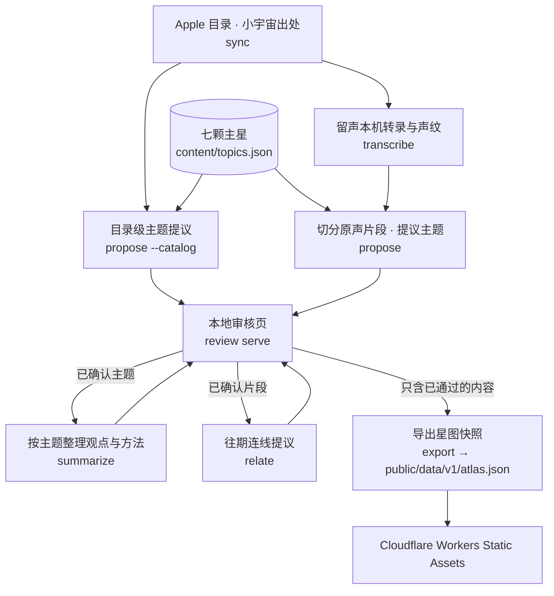

# 贝儿说

《次要人生｜Flip Your Mind》的主题星图。七颗主星是节目反复谈到的主题，每颗星连着往期的具体片段，点一下就从那一段原声开始听。

转录、主题判断和审核都在 Mac 上完成。Cloudflare 只托管网页和审核通过的数据快照。

## Architecture



关键规则：

- **先确认主题，再总结。** 未确认主题的片段不会进入总结，调用 `summarize` 只会得到「待确认」。
- **片段 ID 和时间戳无关。** 修正起播点后，分享出去的链接仍然有效。连线引用两个片段的 ID。
- **只发布审核过的内容。** 模型的提议、逐字稿和音频都只留在本机（`var/`）。快照里只有主题、单集目录、已通过的片段和连线。
- **重新提议只退回受影响的那一项。** 被重新提议的单集或连线回到「待审」，公开快照继续用它上一版通过的内容，直到新版本通过。驳回则会把它从快照里撤下。

### 阶段

| 阶段 | 数据来源 | 产出 |
| --- | --- | --- |
| M1 目录版 | 单集标题、官方主题、892 个章节标题 | 单集和章节的主题、章节之间的「节目导读」连线 |
| M2 试点 | EP45（独白）+ 一集对谈的原声 | 按说话人分段的逐字稿、原声片段、观点和方法、往期连线 |
| M3 首批 | EP45–51 | 第一次部署到 Cloudflare |
| M4 全档 | 54 集 | 后台续跑转录，批量提议后进入审核 |

## 本地和 Cloudflare 各用什么

| 位置 | 技术栈 | 职责 |
| --- | --- | --- |
| Mac 内容流水线 | Python 3.12、SQLite、留声适配层、Claude Code 会话（Claude Opus 5.5） | `sync → transcribe → propose → review → summarize → relate → export` |
| 本地 Web 开发 | React 19、TypeScript、Three.js + postprocessing、Vite、Cloudflare Vite 插件、Wrangler | `npm run dev` 读取当前快照，`npm run preview` 在本地 Workers runtime 里跑生产构建 |
| Cloudflare | Workers Static Assets | 托管网页、`/data/v1/atlas.json` 和字体子集。音频由浏览器直接请求原节目音源 |

**谁来判断主题和连线。** 在 Claude Code 会话里由 Claude Opus 5.5 直接读目录，把提议写成 `content/proposals/*.json`，再用 `propose --catalog --from-file` 导入审核队列，不需要 API key。提议文件留在 git 里，可以追溯每一条来自哪次会话。整档节目的目录不大，可以整份读完再判断连线，所以不另外搭向量检索。

（`pipeline/llm.py` 保留了直接调用 Anthropic API 的路径，供以后批量处理逐字稿时选用；默认流程不用它。）

## 本地依赖

- Python 3.12（3.13 删掉了 `audioop`，留声的转录模块还在用）
- Node 22.12+
- [留声 / Daily Recall](~/Projects/daily-recall) 源码，以及它用到的 Voxt（Qwen3-ASR、Silero VAD）、`campplus.onnx`、`pyannote-segmentation-3-0.onnx`
- `ffmpeg`、`curl`
- 可选：Source Han Serif（思源宋体）可变字体，导出时会按快照里用到的字生成网页字体子集

```bash
/opt/homebrew/bin/python3.12 -m venv .venv
.venv/bin/pip install -r requirements.txt
npm install
```

可调的环境变量：`BEIERSHUO_RECALL_ROOT`（留声源码，默认 `~/Projects/daily-recall`）、`BEIERSHUO_CAM_MODEL`、`BEIERSHUO_DIARIZATION_MODEL`、`BEIERSHUO_WORK_DIR`（默认 `var/`）、`BEIERSHUO_MODEL`。

## 运行

```bash
.venv/bin/python -m pipeline sync                  # 拉取 Apple 目录（54 集）
.venv/bin/python -m pipeline propose --catalog --from-file content/proposals/catalog-1.json   # 导入会话写好的提议
.venv/bin/python -m pipeline propose --catalog --from-file content/proposals/catalog-2.json
.venv/bin/python -m pipeline propose --catalog --from-file content/proposals/links.json
.venv/bin/python -m pipeline review serve          # 打开 http://127.0.0.1:8787 审核
.venv/bin/python -m pipeline export                # 写 public/data/v1/atlas.json 和字体子集
.venv/bin/python -m pipeline status
npm run dev
```

覆盖报告在 `var/reports/catalog-coverage.md`，列出每颗星挂了多少单集和章节，以及七颗星都放不进去的主题。如果某个主题反复出现，先改 `content/topics.json`，再在会话里重写提议文件，用 `--redo` 重新导入。

转录（M2）：

```bash
# 至少三段 2–20 秒、只有贝儿在说话的干净原声
.venv/bin/python -m pipeline enroll ep45.m4a@01:02-01:14 ep45.m4a@12:30-12:41 ep46.m4a@03:05-03:17
.venv/bin/python -m pipeline transcribe EP45 EP44
```

转录结果按集保存在 SQLite 里，可以续跑。说话人标签分为 `beier`、`other` 和 `unsure`。

## 人物、书、概念和搜索

- `content/entities.json`：人物、书和概念的清单（名字、别名、一句话说明、书的作者、概念相关的人）。导出时自动在单集标题、章节标题和节目简介的延伸书目里找出它们出现的位置，新单集不用手动补。每一项有自己的页面：`/people/winnicott`、`/books/body-keeps-the-score`、`/concepts/false-self`。
- `content/keywords.json`：听众可能搜的日常词（内耗、安全感、迷茫……）。导出时统计每个词在标题里出现的次数，没出现过的不会进快照。
- 搜索是全屏的：人物、书、概念、主题和关键词在一个缓慢转动的球面上漂浮，输入时命中的词飘到前面，下方按主题、人物·书·概念、片段分组列出结果。`⌘K` 打开，`Esc` 关闭。
- `content/episodes.json`：单集的附加设置。`musicBed: true` 表示这一集自带背景音乐。

## 背景音乐

网站循环播放 `public/audio/bgm.mp3`（《Iki》Hideyuki Hashimoto）。打开页面就自动播放。个别浏览器会拦住带声音的自动播放，这时第一次点击页面后开始。右下角的小按钮可以开关，偏好记在本机。播放时按钮旁边显示署名：`《Iki》Hideyuki Hashimoto`（`src/ambient.ts` 里的 `TRACK_CREDIT`）。

播放单集时背景音乐自动压低；如果这一集在 `content/episodes.json` 里标了 `musicBed`（目前是 EP50、EP51），背景音乐完全静音。

没有这个文件时，退回浏览器里实时生成的原创音乐（D 大调五声音阶上的稀疏钢琴音和柔和的铺底，加长混响）。节目里的音乐不从单集音频里分离出来使用。

## 数据结构

`public/data/v1/atlas.json`（类型定义见 `src/domain.ts`）：

| 字段 | 内容 |
| --- | --- |
| `topics` | 七颗主星：稳定 `id`、标题、说明、搜索别名、颜色、3D 位置 |
| `episodes` | Apple GUID 作主键，含小宇宙和 Apple 链接、音源、章节、已确认的 `topicIds` |
| `moments` | 片段：`id`（与时间戳无关）、所属单集、`topicIds`、起止时间、来源（`show_notes` 或 `audio_verified`）、说话人 |
| `relations` | 原声片段之间的连线：两个片段 ID、审核过的理由、类型 |
| `chapterPaths` | 目录阶段的章节连线（「节目导读」）：两端的单集和章节起点、主题、理由、类型 |
| `entities` | 人物、书和概念：说明、别名、作者或相关人物、主题，以及每一处出现的单集、章节和起播点 |
| `keywords` | 搜索建议词和它们在标题里出现的次数 |

本地 SQLite（`var/content.sqlite3`）：`episodes`、`transcripts`、`proposals`（模型提议和审核决定）、`summaries`、`jobs`。

深链：`/?topic=boundaries&moment=m-…` 会恢复焦点星和片段，点「听这一段」从起播点开始播放。

## 发布

```bash
.venv/bin/python -m pipeline export
npm run build          # tsc + vite build，输出到 dist/
npm run preview        # 本地 Workers runtime 验证深链和起播
npx wrangler login     # 第一次部署前
npm run deploy
```

发布前检查：`export` 会校验所有主题、单集、片段和连线引用；`dist/` 里只应有网页、`data/v1/atlas.json` 和 `fonts/`。

字体：`public/fonts/beier-serif-*.woff2` 是思源宋体的子集，按 SIL Open Font License 1.1 分发，见 `public/fonts/NOTICE.txt`。
